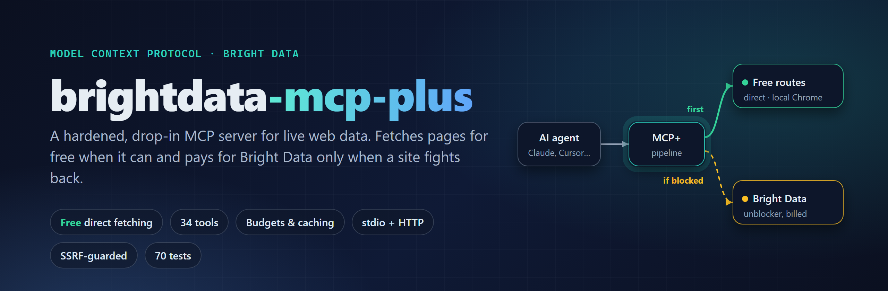
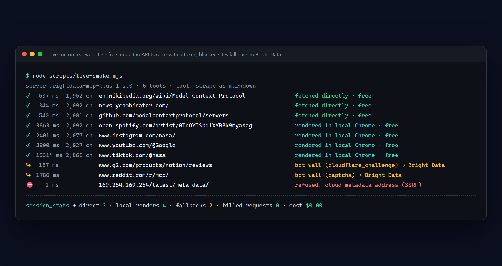
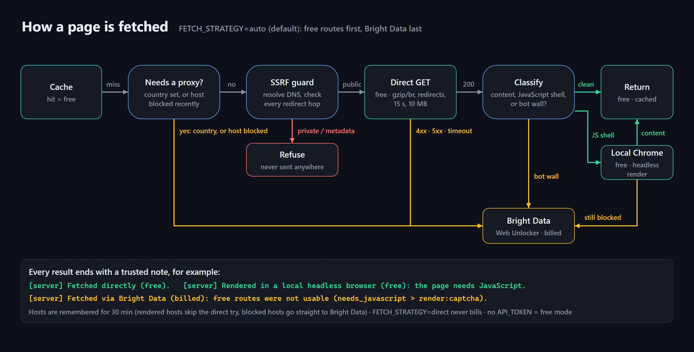
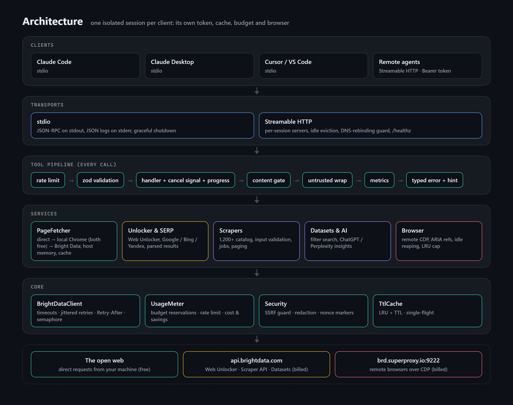

<p align="center">
  
</p>

<p align="center">
  <a href="LICENSE"></a>
  
  
  
  <a href="https://github.com/wikydtron/brightdata-mcp-plus/actions/workflows/ci.yml"></a>
  
  
</p>

**brightdata-mcp-plus** is a [Model Context Protocol](https://modelcontextprotocol.io) server that gives AI agents
(Claude Code, Claude Desktop, Cursor, VS Code, any MCP client) reliable access to live web data: page fetching,
search, 1,200+ pre-built scrapers, datasets and remote browsers.

It is a ground-up TypeScript rebuild of the official [`@brightdata/mcp`](https://github.com/brightdata/brightdata-mcp),
keeping its tool names and environment variables so it works as a drop-in replacement, and adding what it was missing:
**free direct fetching with automatic fallback**, spending guards, caching, pagination, cancellation, retries, an
SSRF guard, a built-in HTTP transport and a real test suite.

> Unofficial project, not affiliated with Bright Data. Bright Data features (search, scrapers, unblocking, remote
> browsers) need your own [Bright Data API token](https://brightdata.com/cp/setting/users) and are billed by Bright Data.
> Plain page fetching works with no account at all.

## Contents

- [Why it costs less](#why-it-costs-less)
- [Quick start](#quick-start)
- [Connect your client](#connect-your-client)
- [How page fetching works](#how-page-fetching-works)
- [Tools](#tools-34)
- [Configuration](#configuration)
- [Cost control](#cost-control)
- [Security model](#security-model)
- [Architecture](#architecture)
- [Compared with @brightdata/mcp](#compared-with-brightdatamcp)
- [Development](#development)
- [FAQ](#faq)

## Why it costs less

Bright Data charges per request. Most pages an agent reads (docs, blogs, news, GitHub, package registries, Wikipedia)
don't block ordinary requests, so paying a proxy network to fetch them is wasted money. This server tries two free
routes first:

1. **Direct fetch** from your machine: plain HTTP, fast, works for most of the web.
2. **Local headless Chrome** (or Edge) when the page is a JavaScript-only app shell: Spotify, Instagram, YouTube,
   TikTok, Figma, Duolingo and other single-page apps render for free on your own browser.

Only real bot walls (Cloudflare challenges, DataDome, PerimeterX, CAPTCHAs) go to Bright Data. Repeated fetches come
from a cache, also free.

<p align="center"></p>

That screenshot is a real run of [`scripts/live-smoke.mjs`](scripts/live-smoke.mjs) against live websites with no API
token. Wikipedia, Hacker News and GitHub were fetched directly. Spotify, Instagram, YouTube and TikTok, which send an
empty shell to plain HTTP clients, were rendered in a local headless Chrome and returned their real content
(follower counts, bios, video and track lists). G2's Cloudflare challenge and Reddit's CAPTCHA were detected; with a
token these go to Bright Data automatically. An attempt to read the cloud-metadata address was refused by the SSRF
guard. Every result tells the agent how it was fetched:

```text
[server] Fetched directly (free).
[server] Rendered in a local headless browser (free): the page needs JavaScript.
[server] Fetched via Bright Data (billed): free routes were not usable (needs_javascript > render:captcha).
[server] Served from cache (originally via free direct fetch; no cost).
```

## Quick start

Requires **Node.js 22+**.

```bash
git clone https://github.com/wikydtron/brightdata-mcp-plus.git
cd brightdata-mcp-plus
npm install        # also builds (prepare script)
npm test           # optional: 70 tests, ~10 s
```

Or run it straight from GitHub without cloning:

```bash
npx -y github:wikydtron/brightdata-mcp-plus --list-tools
```

**Free mode (no account):** start it without `API_TOKEN`. You get `scrape_as_markdown`, `scrape_batch`,
`scrape_as_html`, `extract` and `session_stats`, fetching directly and rendering JavaScript apps in your local Chrome
or Edge (found automatically; set `CHROME_PATH` otherwise). Add `BROWSER_CDP_ENDPOINT` to drive your own Chrome with
the interactive browser tools too.

**Full mode:** set `API_TOKEN` to unlock search, scrapers, datasets, AI-insights and Bright Data's remote browsers,
with direct-first fetching still saving requests. Check your token and zones first:

```bash
API_TOKEN=your_token node dist/src/index.js --check
```

## Connect your client

<details open>
<summary><b>Claude Code</b></summary>

```bash
claude mcp add brightdata -e API_TOKEN=your_token -- node /absolute/path/to/brightdata-mcp-plus/dist/src/index.js
```
Leave out `-e API_TOKEN=...` for free mode.
</details>

<details>
<summary><b>Claude Desktop</b> (<code>claude_desktop_config.json</code>)</summary>

```json
{
  "mcpServers": {
    "brightdata": {
      "command": "node",
      "args": ["/absolute/path/to/brightdata-mcp-plus/dist/src/index.js"],
      "env": { "API_TOKEN": "your_token", "BUDGET_MAX_REQUESTS": "500" }
    }
  }
}
```
</details>

<details>
<summary><b>Cursor</b> (<code>~/.cursor/mcp.json</code>) and <b>VS Code</b> (<code>.vscode/mcp.json</code>)</summary>

```json
{
  "mcpServers": {
    "brightdata": {
      "command": "node",
      "args": ["/absolute/path/to/brightdata-mcp-plus/dist/src/index.js"],
      "env": { "API_TOKEN": "your_token" }
    }
  }
}
```
VS Code uses `"servers"` instead of `"mcpServers"` as the top-level key.
</details>

<details>
<summary><b>Remote clients over HTTP</b></summary>

```bash
node dist/src/index.js --transport http --port 3000
```

Clients connect to `http://127.0.0.1:3000/mcp` with `Authorization: Bearer <bright data token>`. Each MCP session gets
its own token, cache, budget and browser, so one server can serve several people. `?groups=` and `?tools=` work like on
Bright Data's hosted server; `?token=` is accepted for compatibility but logs a warning because URLs end up in logs.
Binding to a non-loopback address with a shared `API_TOKEN` requires `HTTP_AUTH_SECRET` (sent by clients as
`x-mcp-auth`). Health check: `GET /healthz`.
</details>

<details>
<summary><b>Docker</b></summary>

```bash
docker build -t brightdata-mcp-plus .
docker run -i --rm -e API_TOKEN=your_token brightdata-mcp-plus
```
</details>

## How page fetching works

<p align="center"></p>

| `FETCH_STRATEGY` | Behaviour | Cost |
|---|---|---|
| `auto` (default) | Direct, then local Chrome for JavaScript apps, then Bright Data Web Unlocker for bot walls and failures | Only bot-walled pages are billed |
| `direct` | Direct and local Chrome only; blocked pages return an error with the reason | Never billed |
| `brightdata` | Always Web Unlocker (upstream behaviour) | Every fetch billed |
| *(no `API_TOKEN`)* | Free mode: `direct`, Bright Data tools hidden | Free |

Details:
- **Bot-wall detection** looks for Cloudflare challenges, DataDome, Imperva, PerimeterX, AWS WAF, Google's
  "unusual traffic" page, CAPTCHA widgets and JavaScript-only shells. CAPTCHA keywords only count on short pages, so
  an article with a reCAPTCHA contact form is still fetched for free. Rendered pages are classified again, so a bot
  wall that only appears after JavaScript runs is still caught.
- **Local rendering** uses your installed Chrome or Edge through `playwright-core` (no browser download). One
  headless browser is shared by all sessions, each render gets a fresh incognito context, images, media and fonts
  are skipped, and the browser closes after 2 idle minutes. A render finishes as soon as the app has produced text
  or its network goes quiet, so an empty shell fails over in about a second instead of waiting out a timeout. It renders pages; it does not try to
  evade bot detection, so walls still go to Bright Data, which exists for that.
- **Host memory:** for 30 minutes, a host that needed rendering skips the direct attempt, and a host that blocked
  goes straight to Bright Data.
- **Country routing** (`country: "de"`) always uses Bright Data, since geo-targeting needs a proxy.
- Direct fetches follow up to 5 redirects, decode gzip/deflate/brotli, honour the page charset, stop at 15 s and
  10 MB, and convert HTML to Markdown with absolute links.
- **Limits:** apps that keep streaming data after the first paint (Google Maps, live trading charts) may render only
  their UI chrome. For structured data from those, use a pre-built scraper (`search_scrapers "google maps"`) or the
  interactive `scraping_browser_*` tools.

## Tools (34)

<details open>
<summary><b>Search and fetch</b></summary>

| Tool | What it does | Key options |
|---|---|---|
| `search_engine` | Google (ranked JSON), Bing or Yandex (Markdown) | `engine`, `geo_location`, `language`, `time_range`, `cursor`, `fresh` |
| `search_engine_batch` | Up to 10 searches in parallel | `queries[]` |
| `scrape_as_markdown` | One page as compact Markdown, direct-first | `format` (markdown/text/raw), `offset`, `max_chars`, `country`, `fresh` |
| `scrape_batch` | Up to 10 pages in parallel, each with its `source` | `urls[]`, `max_chars_per_url` |
| `scrape_as_html` | Raw HTML, paginated | `offset`, `max_chars` |
| `extract` | Page to JSON using **your own model** via MCP sampling | `extraction_prompt`, `schema` (JSON Schema) |
</details>

<details>
<summary><b>Pre-built scrapers</b> (Bright Data Web Scraper API, 1,200+ sites)</summary>

| Tool | What it does |
|---|---|
| `search_scrapers` | Ranked search of the scraper catalog by site, domain, data type or `gd_` id |
| `get_scraper_details` | Input fields (with required flags), example input, output fields |
| `run_scraper` | Validates input **before anything is billed**, enforces `MAX_RECORDS_PER_RUN`, waits up to `wait_seconds`, pages records |
| `get_scraper_progress` | Job status |
| `get_scraper_results` | Records with `offset`/`limit`; finished snapshots are cached so paging is free |
| `refresh_scrapers` | Reload the catalog now |
</details>

<details>
<summary><b>Datasets, AI and meta</b></summary>

| Tool | What it does |
|---|---|
| `list_dataset_fields` / `search_dataset` | Filter search over LinkedIn people and company datasets |
| `chatgpt_ai_insights` / `perplexity_ai_insights` | Ask ChatGPT or Perplexity (for GEO / brand visibility); long jobs return a `snapshot_id` instead of failing |
| `ask_brightdata_assistant` | Bright Data's support assistant, with threaded follow-ups |
| `session_stats` | Calls, errors, p50/p95 latency, cache hits, billable units, estimated cost, free fetches and savings, budget left |
</details>

<details>
<summary><b>Browser</b> (Bright Data Browser API, or your own Chrome via <code>BROWSER_CDP_ENDPOINT</code>)</summary>

`scraping_browser_navigate`, `_go_back`, `_go_forward`, `_snapshot` (ARIA refs, optional filtering), `_click_ref`,
`_type_ref`, `_press_key`, `_fill_form`, `_screenshot` (JPEG by default), `_get_text`, `_get_html` (both paginated),
`_scroll` (top/bottom/up/down), `_scroll_to_ref`, `_wait_for_ref`, `_network_requests` (filter by type or URL),
`_close`. Idle browsers close automatically and open sessions are capped.
</details>

Prompts: `web_scraping_strategy` and `diagnose_scraping_approach` (takes a `url`).

## Configuration

All settings are environment variables (names compatible with `@brightdata/mcp`). Run `--help` for CLI flags.

| Variable | Default | Purpose |
|---|---|---|
| `API_TOKEN` | — | Bright Data API token. Without it: free mode |
| `FETCH_STRATEGY` | `auto` | `auto`, `direct` or `brightdata` (see above) |
| `DIRECT_TIMEOUT` / `DIRECT_MAX_BYTES` | `15` s / `10000000` | Limits for direct fetches |
| `DIRECT_USER_AGENT` | Chrome UA | User-Agent for direct fetches |
| `DIRECT_ALLOW_PRIVATE` | `false` | Allow direct fetches and renders of localhost/LAN addresses |
| `LOCAL_RENDER` | `on` | Render JavaScript apps in local Chrome/Edge before paying Bright Data (`off` to disable) |
| `CHROME_PATH` | auto | Browser executable if Chrome/Edge isn't in its standard location |
| `LOCAL_RENDER_TIMEOUT` / `LOCAL_RENDER_IDLE` | `25` s / `120` s | Per-render limit; close the browser after this idle time |
| `LOCAL_RENDER_ON` | `needs_javascript,empty` | Direct-fetch results that trigger a local render |
| `LOCAL_RENDER_CONCURRENCY` | `2` | Parallel renders |
| `WEB_UNLOCKER_ZONE` / `BROWSER_ZONE` | `mcp_unlocker` / `mcp_browser` | Zone names |
| `AUTO_CREATE_ZONES` | `true` | Create missing zones at startup |
| `GROUPS` / `TOOLS` | all | Limit tools; legacy `web_data_*` names map to the new tools |
| `BUDGET_MAX_REQUESTS` | `0` (off) | Max billable units per session |
| `MAX_RECORDS_PER_RUN` | `200` | Refuse scraper runs that could return more billed records |
| `RATE_LIMIT` | off | Local limit for all tools, e.g. `100/1h` |
| `PRICE_PER_1K` | `1.5` | USD per 1K results, for estimates only |
| `BASE_TIMEOUT` / `BASE_MAX_RETRIES` | `90` s / `2` | Bright Data API timeout and retries |
| `MAX_CONCURRENCY` | `5` | Concurrent upstream requests per session |
| `CACHE_TTL` / `CACHE_MAX_ENTRIES` | `300` s / `200` | Response cache (`0` disables) |
| `MAX_OUTPUT_CHARS` | `60000` | Default page size for content tools |
| `CONTENT_GATE` / `CONTENT_GATE_TIMEOUT` | `on` / `120` s | Prompt-injection gate |
| `BROWSER_IDLE_TIMEOUT` / `MAX_BROWSER_SESSIONS` | `300` s / `3` | Browser reaping and cap |
| `BROWSER_CDP_ENDPOINT` | — | Use your own Chromium (`ws://…/devtools/browser/…`) |
| `BROWSER_FILTERED_SNAPSHOT` | off | Always filter snapshots |
| `MCP_TRANSPORT`, `HOST`, `PORT` | `stdio`, `127.0.0.1`, `3000` | Transport |
| `HTTP_AUTH_SECRET`, `HTTP_SESSION_IDLE_TIMEOUT` | —, `1800` s | HTTP access secret, idle timeout |
| `LOG_LEVEL` | `info` | `debug`, `info`, `warn`, `error`, `silent` |

## Cost control

- **Budget:** `BUDGET_MAX_REQUESTS=500` stops a session before its 501st billable unit. Units are *reserved* before
  each call, so parallel calls can't overshoot together. Cached pages stay available after the budget is spent.
- **Scraper guard:** `run_scraper` refuses `discover_by_*` runs whose worst case (`inputs × limit_per_input`) exceeds
  `MAX_RECORDS_PER_RUN`, and checks required input fields before triggering, so typos are never billed.
- **No double billing:** job triggers are retried only when Bright Data rejected them (429), never after a timeout
  that may have started a job.
- **Visibility:** `session_stats` returns

```json
{
  "fetch_strategy": "auto",
  "local_rendering": "on",
  "billable": { "unlocker_requests": 3, "scraper_records": 10, "dataset_records": 0, "browser_navigations": 0 },
  "estimated_cost_usd": 0.0195,
  "free": { "direct_fetches": 42, "local_renders": 9, "fallbacks": 3, "estimated_savings_usd": 0.0765 },
  "budget": { "max": 500, "used": 13, "remaining": 487 },
  "tools": { "scrape_as_markdown": { "calls": 45, "errors": 0, "cache_hits": 6, "p50_ms": 410, "p95_ms": 1890 } }
}
```

## Security model

| Threat | Defence |
|---|---|
| Prompt injection in web content | Every web result is wrapped between `=====UNTRUSTED_<random nonce>_BEGIN/END=====` markers with a notice; forged markers are scrubbed |
| Pages telling the agent to change its MCP config | Content gate: matching content is withheld unless the user approves it through MCP elicitation |
| SSRF (agent tricked into reading `169.254.169.254`, your router, local services) | Direct fetches resolve DNS and refuse private, loopback, link-local and metadata ranges on every redirect hop; the local renderer only opens URLs whose redirect chain passed that check, blocks every in-page request to those ranges, and discards a page that ends up on one |
| Credential leaks | API token, zone passwords and URL credentials are redacted from logs and errors; the token is never put in a URL |
| Ambiguous browser refs | A ref that appears more than once in the snapshot (e.g. echoed by page text) is refused |
| Exposed HTTP server | Loopback by default, DNS-rebinding protection, `HTTP_AUTH_SECRET` required for shared tokens on public interfaces |

## Architecture

<p align="center"></p>

```text
src/
  index.ts            CLI: flags, --check, --list-tools, stdio startup, graceful shutdown
  config.ts           Validated config (env + flags)
  server.ts           createSession(): one isolated McpServer + services; the tool pipeline
  http/client.ts      The only path to the Bright Data API: auth, timeouts, retries, concurrency, typed errors
  http/server.ts      Streamable HTTP transport with per-session isolation
  services/           pages (direct → render → Bright Data), direct (SSRF-safe fetch + classifier),
                      render (local headless Chrome), unlocker, serp, scrapers, datasets, assistant,
                      browser, zones
  tools/              Tool definitions (zod schemas, annotations), grouped by area
  security/           Untrusted-content wrapping, prompt-injection content gate
  usage.ts            Stats, budget reservations, rate limiting, savings
  util/               Cache, semaphore, pagination, Markdown minifier, redaction
```

## Compared with @brightdata/mcp

| Area | `@brightdata/mcp` 4.1.0 | brightdata-mcp-plus |
|---|---|---|
| Page fetching | Every fetch billed | Direct, then local headless Chrome for JavaScript apps (both free), Bright Data only for bot walls; free mode with no account |
| Language | ~2.8k lines of untyped JS | Strict TypeScript, layered |
| Timeouts | None by default; two tools ignore `BASE_TIMEOUT` | Every call (90 s default) |
| Retries | Off by default, no backoff | Jittered backoff, `Retry-After`, never re-triggers billed jobs |
| Cancellation | Ignored; polling can run 10 min after the client gave up | Aborts requests, polling and queued work |
| Batch size | Docs say 10, code allows 5 | 10 |
| Caching | None | TTL + LRU, single-flight |
| Large pages | Returned whole | Paginated with `next_offset` |
| Cost guards | None | Budget, per-run record cap, pre-billing input validation |
| Free-tier message | Missing for scraper and browser tools | Every tool |
| `RATE_LIMIT` | Browser tools skip it | Every tool |
| `extract` | Samples from the first session, not the caller | Calling session, optional JSON Schema |
| HTTP | Hosted only, token in URL | Built in, header auth, per-session isolation |
| SSRF protection | n/a | Private-range guard on every hop |
| Docker | Image copies 3 of 15 modules | Multi-stage, non-root, healthcheck |
| Tests | Unit and stub tests | 70: unit, fake Bright Data API, real MCP clients over in-memory/stdio/HTTP, real headless Chrome (CDP and local rendering) |

## Development

```bash
npm run build          # tsc
npm test               # build + 70 tests (browser and render tests use local Chrome/Edge if found)
npm run typecheck
node scripts/live-smoke.mjs                                 # real sites, free mode, no cost
node scripts/live-smoke.mjs --json assets/src/live-run.json # refresh demo data
node scripts/render-assets.mjs                              # re-render README images (needs Chrome/Edge)
```

Test suites: `unit` (config, cache, semaphore, errors, security, SERP, pagination, scoring, budget),
`client` (retries, Retry-After, timeouts, cancellation, headers), `e2e` (all tool families through a real MCP client),
`direct` (direct fetching, bot-wall detection, fallback, SSRF, free mode), `render` (local Chrome: client-rendered
pages, XHR, walls that appear after JavaScript, host memory, in-browser SSRF guard), `http` (multi-tenant HTTP),
`stdio` (the built CLI as a subprocess) and `browser` (a real headless Chrome over CDP).

## FAQ

**Is it free?** Fetching pages directly and rendering them in your own Chrome is free. Bright Data's own services
(search, scrapers, unblocking protected sites, remote browsers) run on their infrastructure and are billed to your
Bright Data account; their free tier is 5,000 requests a month. This server just makes sure you only use them when
needed.

**Why did a page cost a request?** The result note says why, e.g. `cloudflare_challenge` or
`needs_javascript > render:captcha` (a JavaScript app that showed a CAPTCHA even to a real browser). Use
`FETCH_STRATEGY=direct` to never pay, at the cost of failing on protected sites.

**Do I need Chrome?** No. Without Chrome or Edge the render step is skipped (`session_stats` shows
`local_rendering: "unavailable"`) and JavaScript apps go to Bright Data as before.

**Is direct fetching allowed?** It's an ordinary HTTP request from your machine, like a browser. You are responsible
for respecting each site's terms and robots rules.

**Is this official?** No. It's an independent MIT-licensed project derived from
[brightdata/brightdata-mcp](https://github.com/brightdata/brightdata-mcp) (MIT, see [LICENSE.upstream](LICENSE.upstream)).

## License

[MIT](LICENSE)
